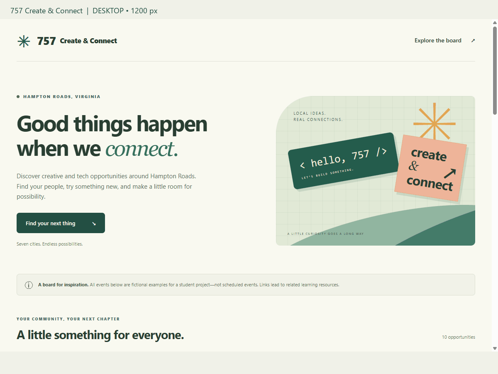

# Web Development Project 1 - *757 Create & Connect*

Submitted by: **Erin Joel Moore**

This web app: **A creative and technology community board for Hampton Roads featuring ten clearly labeled fictional event concepts and related learning resources.**

Time spent: **10** hours spent in total

## Required Features

The following **required** functionality is completed:

- [x] **The app has a cohesive, unique theme for events or resources relevant to a specific community**
  - [x] Header/title describing the theme is displayed
- [x] **At least 10 unique events or resources are displayed in a responsive card format**
  - [x] There are at least 10 cards displayed for 10 different events
  - [x] The cards should be displayed in an organized format (ex. a grid, or in one line)
  - [x] Each card should include some information about the event or resource

The following **optional** features are implemented:

- [x] Buttons or links to a related resources are on each card component
  - [x] All cards have buttons or links in addition to text
- [x] The site is responsive for both desktop and mobile formats
  - [x] Web app is shown in a mobile format
  - [ ] **Video Walkthrough Special Instructions**: To ease the grading process, please use Chrome Developer Tools' "Toggle Device" button to demonstrate that your web application's responsiveness in both a desktop *and* a mobile format. Detailed instructions can be found below this stretch feature on the project page.

The following **additional** features are implemented:

* [x] Category filters and an updating opportunity count.
* [x] Accessible filter states, keyboard focus styles, skip link, and reduced-motion support.
* [x] Custom coastal illustrations and footer links to CodePath and Rinnyssance's GitHub.
* [x] Clear fictional-event labels and a site-wide explanation.

## Video Walkthrough

Here's a walkthrough of implemented required features:



GIF created with browser screenshots and Pillow. It shows all ten cards, category filtering, and desktop and mobile layouts. The Chrome DevTools Toggle Device button demonstration remains to be recorded for the specific optional instruction above.

## Notes

This project helps people explore creative and technology interests around Hampton Roads. The ten events are fictional examples; their links lead to related learning resources.

- **src/App.jsx** builds the main page: the header, welcome section, example-event notice, category filters, card grid, and footer. It tracks the selected category and updates the displayed cards and opportunity count.
- **src/components/Card.jsx** is the reusable event card. It displays an illustration, category, title, description, concept location, and resource link from the event information it receives.
- **src/data.js** stores the ten event concepts, including their categories, descriptions, cities, colors, and links. Keeping this information in one place makes it easier to add or edit cards.
- **src/App.css** styles the page, illustrations, buttons, and cards. Its media queries change the card grid from three columns to two and then one as the screen narrows.
- **src/index.css** supplies the site's shared font, background, box sizing, and smooth scrolling.
- **src/main.jsx** starts React and renders the app inside the root element.
- **index.html** provides that root element, the browser tab title, and page metadata.
- **package.json** lists dependencies and commands for starting the app, building it, and checking the code.
- **package-lock.json** records exact dependency versions for consistent installs.
- **vite.config.js** configures Vite and its React plugin.
- **postcss.config.js** keeps CSS processing local to this project so unrelated parent-folder settings do not interfere.
- **.oxlintrc.json** configures the JavaScript and React code checks.
- **.gitignore** keeps generated files, dependencies, and local settings out of the repository.
- **public/walkthrough.gif** shows the working project at desktop and mobile sizes.
- **README.md** documents the project, completed features, setup, and walkthrough.

Run locally with Node.js 22.12+:

```sh
npm install
npm run dev
```

Production check: `npm run build`. Code check: `npm run lint`.

## License

    Copyright 2026 Erin Joel Moore

    Licensed under the Apache License, Version 2.0 (the "License");
    you may not use this file except in compliance with the License.
    You may obtain a copy of the License at

        http://www.apache.org/licenses/LICENSE-2.0

    Unless required by applicable law or agreed to in writing, software
    distributed under the License is distributed on an "AS IS" BASIS,
    WITHOUT WARRANTIES OR CONDITIONS OF ANY KIND, either express or implied.
    See the License for the specific language governing permissions and
    limitations under the License.


