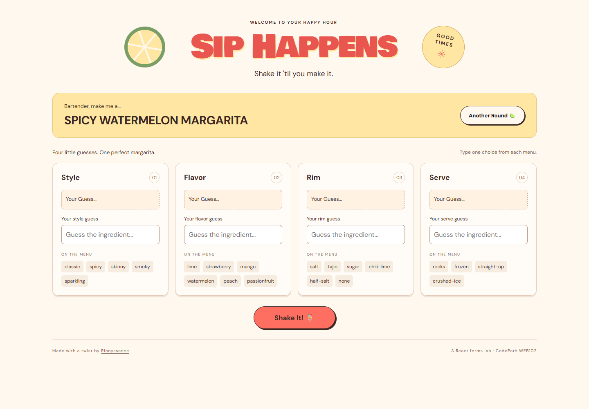

# Sip Happens

**Sip Happens** is my adaptation of CodePath WEB102's Unit 3 lab, **On My Grind**. It is a recipe-guessing application built with React, JavaScript, and Vite. I replaced the original coffee theme with margaritas while retaining the lab's central programming task: collect four controlled inputs, compare them with structured recipe data, and display feedback for each answer.

[Live application](https://siphappens-codepath.vercel.app) · [GitHub repository](https://github.com/rinnyssance/siphappens-codepath) · [Author: Rinnyssance](https://github.com/rinnyssance)



## Project Overview

The application displays one randomly selected margarita from a local JSON file. The player guesses its style, flavor, rim, and serving method using the choices listed under each input. Selecting **Shake It!** validates the guesses and compares each valid response with the current recipe. Correct answers receive green feedback, while incorrect answers receive coral feedback and a prompt to try again. The application does not reveal the correct recipe automatically.

**Another Round** selects a random drink and clears the guesses, validation messages, and correctness indicators. Random selection can occasionally return the same drink. The 12 recipes define the answers for this game; they are not intended to establish a single universal recipe for each margarita.

## Learning Objectives and Implementation

This project demonstrates how React connects application state to an interactive interface. `BaristaForm` owns one `inputs` object with four properties. Each text field receives its value from that object, making it a controlled input. The shared change handler uses the input's `name` to update the matching property while preserving the other guesses through the object spread operator.

`RecipeChoices` is a reusable child component. Its props provide the category label, available choices, current input value, change handler, and validation message. Rendering this component for each category avoids four separate implementations of the same interaction. The choice lists are generated with `.map()` rather than written individually into the markup.

The imported `drinks.json` file separates recipe content from interface logic. `getNextDrink()` uses `Math.random()` to choose an array index, then stores the drink's name and recipe in state. Four individual correctness states control the `correct` and `wrong` CSS classes. This preserves the lab's emphasis on independent comparisons and conditional rendering rather than replacing it with a different scoring system.

For the stretch feature, validation uses each category's array and `.includes()` to reject unsupported values. Leading and trailing spaces and capitalization are normalized before checking. Invalid entries produce inline messages and an invalid-input border; valid but incorrect entries receive recipe feedback. CSS variables organize the color palette, while Flexbox and media queries let the cards wrap at smaller screen widths.

## CodePath Assignment Requirements

The following mapping is based on the attached **On My Grind.pdf**, a 25-page copy of the Unit 3 lab. Page numbers refer to that PDF, not a separate grading rubric.

| CodePath requirement | Sip Happens implementation | Status |
| --- | --- | --- |
| Show one drink at a time (p. 2) | One random margarita and its name are displayed | Complete with theme adaptation |
| Choose one answer per category and update the answer box (pp. 2, 9–11) | Controlled radio choices were implemented and verified before the stretch version | Complete in commit `e36edf6` |
| Compare every guess with the recipe and mark each result (pp. 2, 15–16) | Four independent comparisons and conditional correctness classes | Complete |
| Generate a random drink and clear previous inputs (pp. 2, 12–14) | `getNextDrink()` and `onNewDrink()` reset the game | Complete |
| Use a reusable component with props and dynamic choices (pp. 9–11) | `RecipeChoices` receives state and handlers through props | Complete |
| Import recipes from JSON (pp. 12–14) | Local `src/drinks.json` with 12 margaritas | Complete with custom data |
| Organize the interface with Flexbox and distinct answer colors (pp. 17–20) | Responsive cards and `correct`/`wrong` backgrounds | Complete; CSS names differ |
| Stretch: replace radio buttons with text fields and validate against the choice lists (pp. 22–23) | Four controlled text fields, visible menus, and inline validation | Complete |
| Wrap the inputs in an HTML form (pp. 6–7, 17) | Current wrapper is a `section` with a `div` for the cards | Missing; reserved for the next planning stage |

The PDF explicitly permits changing the validation alert to another behavior, such as highlighting the text box (p. 23). Inline error messages therefore satisfy that intent. The final application uses the stretch input mode; the PDF asks for replacing the radio inputs, so a mode toggle is not required.

## Remaining Gaps and Questions

1. **HTML form semantics:** The current inputs are not inside a `<form>` element. The lab's structure uses one. This is a structural gap even though the buttons and input handling work.
2. **Theme and dataset alignment:** The original assignment specifies Starbucks drinks with temperature, milk, syrup, and blended categories, and links to its provided JSON. This project intentionally uses margaritas with style, flavor, rim, and serve. Instructor acceptance of that adaptation has not been verified.
3. **Literal CSS structure:** The walkthrough uses `.container`, `.mini-container`, and `.answer-space`, including Flexbox on both container levels. This implementation uses `.recipe-cards`, `.recipe-card`, and `.answer`, with Flexbox for the outer card layout. The resulting layout works, but it is not a line-for-line reproduction of the walkthrough.
4. **Walkthrough media:** A screenshot is included, but an interaction GIF or video has not been recorded. The original Sip Happens build prompt planned a walkthrough; the attached lab PDF does not explicitly require one.
5. **Submission details:** The attached PDF does not provide a submission checklist, required repository visibility, README template, or attachment instructions. Those details remain unverified rather than assumed.

These points are documented for the next planning stage; the audit did not automatically implement additional features.

## Development Milestones

- `e36edf6` — Complete required radio-button version.
- `b16980b` — Add validated text-input stretch feature.
- The current version includes the updated footer attribution and removes the extra top bar and idle message.

## Project Structure

```text
src/
  components/
    BaristaForm.jsx
    RecipeChoices.jsx
  drinks.json
  App.jsx
  App.css
  index.css
  main.jsx
docs/
  screenshot.png
```

## Running the Project

```bash
npm install
npm run dev
```

Build and check the code:

```bash
npm run build
npm run lint
```

## Verification

Browser checks covered independent input updates, displayed guesses, correct answers, mixed correct/incorrect answers, retries, and resets. The stretch checks also covered empty fields, invalid choices, capitalization, and surrounding spaces. Desktop, tablet, and phone layouts were checked for horizontal overflow. Production builds and lint checks passed during development.

## Walkthrough

The screenshot above documents the current appearance. An interaction GIF/video is pending.
